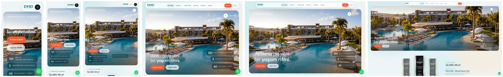
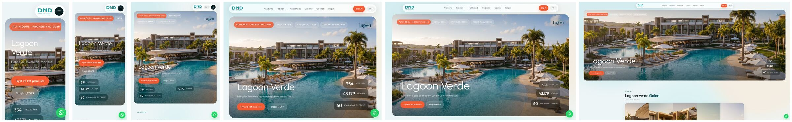
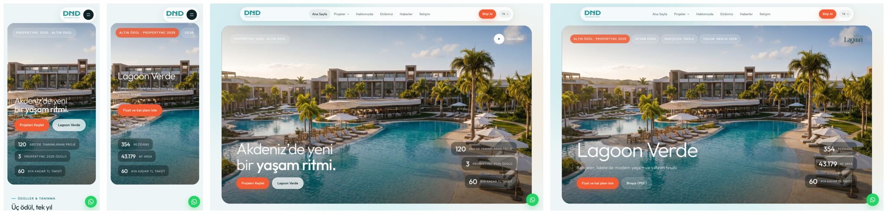

# DND Cyprus Azure: uçtan uca QA raporu (17 Ekim 2026)

Dal: `azure-tasarim` (yalnız yerel commit; push, canlı yayın, DNS ve üretim ayarı değişikliği yok).
Test edilen sürüm: bu rapordaki düzeltmelerin hepsini içeren son commit (bkz. 9. bölüm).
Ölçümler `git archive` yerine APFS klonuyla kurulan ayrı üretim kopyalarında yapıldı (`next build` + `next start`, 3113 ve 3114). 3102'deki geliştirme sunucusuna dokunulmadı.

Bu raporda üç tür bulgu ayrı tutulur:

- **Doğrulanan hata:** tekrarlanarak gösterildi, kanıtı aşağıda.
- **İyileştirme önerisi:** hata değil ya da karar gerektiriyor.
- **Doğrulanamadı:** erişim veya ortam olmadığı için denenemedi.

---

## 1. Genel durum

- Site 5 dilde (TR, EN, DE, RU, PL) 80 sayfayla üretim derlemesinde hatasız açılıyor. Her sayfada tek h1 var, doğru `lang` değeri, JS hatası yok, yatay taşma yok.
- Bulunan **11 doğrulanmış sorun** düzeltildi; davranış hatalarının her biri için otomatik test eklendi. En önemlileri:
  - `#fiyat-al` gibi çapa bağlantıları formu ekranın 1400 px altında bırakıyordu.
  - Kaydırmanın hemen ardından yapılan tıklamalar yutuluyordu (titreme önleminin yan etkisi).
  - Haberler sayfasında öne çıkan haber açılışta görünmüyordu.
  - Güvenlik başlıkları eksikti.
  - Form API'sinde istek sınırı yoktu.
- Bir erişilebilirlik konusu **tasarım kararı bekliyor**: mercan "Bilgi Al" düğmesindeki beyaz yazının kontrastı 3,32:1.
- Bir **ticari bilgi çelişkisi** bulundu ve değiştirilmedi: Lagoon Verde konut sayısı sitede 354, katalogda 365.
- Kalıcı test altyapısı eklendi:
  - Playwright, 4 tarayıcı projesi, 262 test. Son derlemede tam paket 2 kez art arda tekrarlandı (524/524) ve bir kez normal koşuldu (262/262), 0 hata.
  - axe ile erişilebilirlik taraması.
  - Video faststart/H.264 birim testi.
  - GitHub Actions iş akışı.
- "Her şey sorunsuz" denemez. Aşağıdaki 10. bölümde açık konular ve doğrulanamayan alanlar var. En önemlileri:
  - Gerçek iPhone/Android cihaz testi yapılmadı.
  - Gerçek CRM kaydı denenmedi.
  - GA4/Meta/Clarity gerçek kimliklerle denenmedi.
  - Saha (CrUX) verisi yok.

## 2. Test kapsamı

| Alan | Ne yapıldı | Sonuç |
|---|---|---|
| Envanter | Next.js 16.1.1 (Turbopack), React 19.2.3, Tailwind 4, Prisma 7. Rotalar: 16 sayfa × 5 dil = 80 URL, 4 TR blog yazısı, `/tr/qr`, `/admin*`. API: `/api/contact`, `/api/admin-login`, `/api/blog/[slug]` | Envanter çıkarıldı |
| Mevcut CDP paketi (`scripts/e2e`, gerçek Chrome) | 240 sayfa yüklemesi (80 URL × 1440/768/390), 98 bağlantı, 22 etkileşim, yükleme sonrası kayma (hydshift), çapa/hareket/404 kontrolleri | Bağlantı 0 kırık. Etkileşim 22/22 (eskimiş 2 kontrol güncellendi). Kayma bulgusu → hata 3.7 |
| Playwright paketi (yeni, `e2e/`) | chromium-desktop 1440×900, chromium-mobile (Pixel 7), webkit-mobile (iPhone 13), firefox-desktop 1280×800 | **262 test**: normal koşu 262/262; tam paket 2 kez tekrar 524/524 (4 paralel işçi); form, çapa ve kilit testleri ayrıca 5'er kez tekrarlandı. 302 test tasarım gereği atlanıyor (diğer diller ve API/SEO/başlık testleri yalnız masaüstü Chromium'da) |
| Duyarlı tasarım matrisi | Chromium'da 13 boyut (320, 360, 375, 390, 414, 768, 820, 1024, 1280, 1366, 1440, 1920, 2560) ve WebKit'te 4 boyut × 10 sayfa = 170 ölçüm | 0 sorun (yatay taşma, menü taşması, ekrandan taşan metin yok) |
| SEO | Site haritasındaki 80 URL'de title, description, canonical, hreflang, og:image, h1, lang ve robots meta | Hata yok. 14 sayfada açıklama 170 karakteri aşıyor (öneri) |
| Erişilebilirlik | axe-core (WCAG 2.1 A/AA), 6 sayfa × 2 Chromium projesi, klavye odağı | Ciddi ve kritik ihlallerin hepsi düzeltildi; mercan düğme kontrastı karar bekliyor |
| Güvenlik | Yanıt başlıkları, yönetim paneli koruması (sahte çerez dahil), iletişim API'si, açık yönlendirme, ham HTML kullanımları | Bkz. 8. bölüm |
| Formlar | Tarayıcı tarafı: istek tarayıcıda yakalanır (sahte API). Sunucu tarafı: yalnız veritabanına ulaşmayan istekler | Bkz. 8. bölüm |
| Video | `ffprobe` ile 10 MP4: kodek, profil, çözünürlük, bit hızı, faststart | Bkz. 6. bölüm |
| Performans | Lighthouse 12, 3 sayfa × mobil/masaüstü × 3 koşu, düzeltme öncesi ve sonrası | Bkz. 5. bölüm |

**Kullanılan veri ve sınırlar:** Yerelde `.env` yok. Bu yüzden veritabanı, CRM, Meta CAPI ve GA4/Meta/Clarity kimlikleri boş. Makinede bir Postgres (localhost:5432) çalıştığı için `DATABASE_URL` tanımsızken pg istemcisinin ona bağlanma ihtimaline karşı sunucuya **geçerli** bir form gönderilmedi. Sunucuya yalnız doğrulama hatası veren istekler ve honeypot dolu istekler gönderildi; bunlar veritabanına ulaşmadan dönüyor. Gerçek müşteriye e-posta veya WhatsApp gitmedi, gerçek talep oluşmadı.

## 3. Doğrulanan sorunlar

| # | Sorun | Kanıt | Öncelik |
|---|---|---|---|
| 3.1 | **Haberler:** açılışta "Tüm haberler" başlığı ve öne çıkan haber kartı görünmüyordu (opaklık 0), ancak kaydırınca geliyordu | Playwright: yükleme + 1,5 sn sonra `opacity: 0`; kaydırıp dönünce 1. Nedeni: `controls.start()`, LazyMotion özellikleri yüklenmeden çalışıyordu | Yüksek (kullanıcının "garip yükleniyor" dediği durum) |
| 3.2 | **Haberler:** aynı başlıklı haberler (La Joya tamamlandı: Yenidüzen ve Haber Kıbrıs birebir aynı, Kıbrıs Postası neredeyse aynı); Net Haber ile Habertürk'te aynı fotoğraf | Başlık ve kapak listesi | Orta (kullanıcı isteği) |
| 3.3 | **Kaydırmadan hemen sonra yapılan tıklama yutuluyordu.** Titremeyi önlemek için kaydırırken `body`'ye `pointer-events:none` veriliyor ve 160 ms açık kalıyordu. Üç ayrı yol vardı: (a) fare hareket edip tıklama, (b) fare hiç kıpırdamadan tıklama (trackpad ataletini parmakla durdurup basmak), (c) basış ile bırakma arasında kilidin açılması | (a) Firefox: kaydırma + hemen tıklama → 360° tur açılmadı, 400 ms bekleyince açıldı. (b) Yeni `e2e/scroll-lock.spec.ts` eski derlemede 6/6 hata (Chromium + Firefox). (c) Playwright iz kaydı: `pointerdown` hedefi düğme, `mouseup` hedefi `html` | Yüksek |
| 3.4 | **Güvenlik başlıkları yoktu**; `X-Powered-By: Next.js` sürümü açık ediyordu (canlı dndcyprus.com'da da aynı) | `curl -I` | Orta |
| 3.5 | **İletişim API'sinde istek sınırı ve çift kayıt koruması yoktu** (yalnız honeypot vardı) | Kod incelemesi | Orta |
| 3.6 | **Erişilebilirlik (axe, ciddi):** (a) soluk metin tonu (`--ink-40`, 0.42) küçük etiketlerde 2,5:1; (b) gövde metni (`--ink-60`) açık mavi zeminde 4,46:1; (c) katalog sahnesinde rolsüz `aria-label`; (d) Hakkımızda video düğmesi ve Mariachi bağlantısının erişilebilir adı görünen metni içermiyor; (e) telefonda yatay kayan hero etiket şeridi klavyeyle kaydırılamıyor | axe çıktısı (6 sayfa) | Orta |
| 3.7 | **Çapa bağlantıları hedefi kaçırıyordu.** Sonradan uzayan bölümler (katalog `ssr:false` → 0→1000 px, fareli ekranda sabitlenen proje şeridi +1254 px, teknik kartlar +419 px) hedefi aşağı itiyordu | `/tr/lagoon-verde#fiyat-al` doğrudan açılınca form 1417 px aşağıda (ekran dışında, Chromium + WebKit). WebKit'te proje sayfasındaki "Fiyat Al" tıklaması 141–614 px şaşıyordu. `/tr#iletisim` WebKit'te 486 px | **Yüksek** (reklam ve WhatsApp bağlantıları forma yönleniyor) |
| 3.8 | **"Hareketi azalt" açıkken kampanya penceresi videosu oynuyordu** | CDP kontrolü: `playingVideos: 1` (önceki raporda da açıktı) | Düşük |
| 3.9 | **Lagoon Verde sayfasında ve ilk ziyarette 215–676 KB'lık PNG logolar.** 4500 px genişlikteki logolar 44–70 px yükseklikte gösteriliyordu; kampanya penceresinin bağlantısı Lagoon sayfasını önceden çekince logo ana sayfada da iniyordu | Lighthouse ağ listesi, CDP başlatıcı izi (React preload ipucu) | Orta (mobil veri) |
| 3.10 | **Ana sayfa LCP öğesi (hero video afişi) öncelik ipucu almıyordu** | Lighthouse `lcp-discovery-insight`: "fetchpriority=high should be applied" | Düşük |
| 3.11 | **Ana sayfa açılışında ekranın altındaki büyük görseller LCP afişiyle yarışıyordu.** Hikâye bölümünün ilk görseli `eager` (280 KB, sayfanın çok altında); hero'nun hemen altındaki Bento kartları telefonda da 1800 px JPEG iniyordu (389 + 253 KB) | Lighthouse ağ sırası: afişle aynı anda başlayan istekler. Video engellenince bile LCP 8,3 sn kaldı, yani darboğaz video değil | Orta |

**Ticari bilgi çelişkisi (değiştirilmedi):** Lagoon Verde konut sayısı sitede (`lib/azure/site.ts`, `lib/azure/home.tsx` SSS, `lib/azure/projects/lagoon-verde.tsx` bilgi kartı ve JSON-LD) **354**. Katalogun 2. sayfasında (`public/lagoonflip/pages/p-02.webp`, metin görselin içinde) "365 konuttan oluşan proje" yazıyor. Hangisinin güncel olduğu satış ekibine sorulmalı.

**Yanlış alarm olduğu doğrulananlar** (değişiklik yapılmadı):
- Olanak kartlarında "metin taşması": kartın köşesindeki süs ışığı (`::before`) bilerek kırpılıyor, metin tam görünüyor.
- axe'ın Mariachi kartlarında 1,02:1 kontrast bulgusu: animasyonun ortasında ölçülmüş. Bitince metin koyu (`rgb(13,35,38)`). Test artık animasyonların bitmesini bekliyor.
- Mobilde kat planında "İç mekân" görünümünün 4:3 olması: tasarım gereği. Daire tipleri arasında geçişte yükseklik sabit.

## 4. Yapılan düzeltmeler

| Sorun | Düzeltme | Dosya | Doğrulama |
|---|---|---|---|
| 3.1 | `InViewReveal` bildirimsel `animate` kullanıyor (özellikler geç yüklense de görünür duruma geçer) | `app/components/PressSection.tsx` + 4 dil kopyası | Açılışta opaklık 1 (5 dil) |
| 3.2 | 10 yeni olumlu haber eklendi (Ekonomist, Net Haber, Halkın Sesi, Yenidüzen ×2, MHA ×2, Habertürk, Gündem Kıbrıs, Kıbrıs Postası). Aynı başlıklı Yenidüzen ve Kıbrıs Postası "La Joya tamamlandı" kopyaları çıkarıldı. Her habere ayrı kapak verildi (Net Haber'e aynı haberdeki havadan La Joya fotoğrafı). Liste kaynakta da tarihe göre sıralı. İlk 6 haber görünüyor, "Tümünü gör" ile 15 haber açılıyor | 5 basın sayfası, `public/news/*.webp` | 5 dil × 2 ekran: 6 → 15 haber, kırık görsel 0, başlık ve kapak tekrarı 0 |
| 3.3 | Titreme önlemi korunuyor; kilit artık tıklamayı kaybetmiyor: (a) fare gerçekten hareket edince kilit hemen kalkıyor; (b) kilit açıkken basılırsa kilit kalkıyor ve tarayıcının `html`'e düşürdüğü tek tıklama imlecin altındaki öğeye iletiliyor; (c) fare basılıyken kilit hiç açılmıyor | `app/components/azure/AzureFx.tsx` | `e2e/scroll-lock.spec.ts`, Firefox 360° ve form testleri (5'er tekrar) |
| 3.4 | `X-Content-Type-Options: nosniff`, `Referrer-Policy: strict-origin-when-cross-origin`, `X-Frame-Options: SAMEORIGIN`, `Content-Security-Policy: frame-ancestors 'self'`, `Permissions-Policy` (kamera, mikrofon, konum, ödeme, USB kapalı; 360° turun jiroskop izni etkilenmez), `poweredByHeader: false`. Tam CSP bilerek eklenmedi (10. bölüm) | `next.config.ts` | `e2e/security.spec.ts` (sayfa ve 360° tur HTML'i) |
| 3.5 | IP başına 10 dakikada 10 istek (429 + `Retry-After`); aynı `eventId` ikinci kez gelirse yeni kayıt açılmaz. IP için önce `x-real-ip` (Vercel yazar), sonra `x-forwarded-for` | `app/api/contact/route.ts` | `e2e/api.spec.ts`: 10 × 400, 11. istek 429 |
| 3.6 | `--ink-40` 0.42 → 0.62 ve `--ink-60` 0.64 → 0.67 (beyaz ve açık mavide ≥ 4,5:1). Katalog sahnesine `role="group"`. Video düğmesinin adı görünen metinden oluşuyor (+ ekran okuyucuya "videoyu oynat"). Mariachi bağlantısındaki uyumsuz `aria-label` kaldırıldı. Hero etiket şeridi `role="list"`, `tabIndex=0` ve görünür odak halkası aldı | `app/globals.css`, `AzureCatalog.tsx`, `AboutWhoWeAreGlass.tsx` (5 dil), `Mariachi.tsx`, `PageHero.tsx`, `azure.css`, `PressSection.tsx`, `ProjectsFilters.tsx` (5 dil) | `e2e/a11y.spec.ts`: 6 sayfa × 2 projede ciddi/kritik ihlal yok (mercan istisnası not düşülüyor) |
| 3.7 | Sayfa `#bölüm` ile açılınca, sayfa içi `#` bağlantısına tıklanınca ya da adres `#` ile değişince hedefin belgedeki konumu (dönüşümden etkilenmeyen `offsetTop` zinciri) en fazla 8 sn her karede izleniyor. Hedef yer değiştirince yeniden hizalanıyor; kaydırma durunca kalan sapma düzeltiliyor. Kullanıcı tekerlek, dokunma, tuş ya da fare basışıyla (kaydırma çubuğu dahil) bir şey yaparsa izleme hemen bırakılıyor, sayfa geri çekilmiyor | `AzureFx.tsx` | 24 durumun hepsinde 0 px (Chromium + WebKit, 1440 + 390); `e2e/anchors.spec.ts` (doğrudan açılış, tıklama, kullanıcı kaydırınca geri çekmeme) |
| 3.8 | `prefers-reduced-motion` açıksa otomatik oynatma yok, oynatma denetimleri görünür | `app/components/PaymentModelPopup.tsx` | `e2e/anchors.spec.ts` |
| 3.9 | Orijinal PNG'lerden aynı oranlı, 240 px yükseklikte WebP kopyalar: 15–23 KB (önce 215–676 KB). Orijinaller duruyor. Azure veri dosyaları yeni yolu kullanıyor | `public/logos/web/*.webp`, `lib/azure/site.ts`, `lib/azure/projects.tsx`, `lib/azure/projects/mariachi.ts` | Görsel karşılaştırma (aynı kenar payı ve çizim) |
| 3.10 | `preload("/azure/lv-5.jpg", { as: "image", fetchPriority: "high" })` | `app/components/azure/home/HomeHero.tsx` | Laboratuvar LCP'sinde ölçülebilir fark yok (5. bölüm); Lighthouse uyarısı kalktı |
| 3.11 | Hikâye görselleri tümüyle `lazy` (tarayıcı bölüme ~1250 px kala yükler). Bento'nun iki arka plan görseli `next/image` ile ekran boyuna göre AVIF/WebP (kalite 75, sitedeki izinli en yüksek değer); yerleşim aynı (`fill` + mevcut `.bg` kuralı) | `app/components/azure/home/Story.tsx`, `app/components/azure/home/Bento.tsx` | Önce/sonra ekran görüntüsü gözle ayırt edilemiyor (RMSE %1–2); 5. bölüm |

## 5. Performans: öncesi ve sonrası

Lighthouse 12, yerel üretim sunucusu (CDN yok, HTTP/1.1, gzip). Mobil: yavaş 4G ve 4x CPU benzetimi; masaüstü: `--preset=desktop`. Her satır 3 koşunun ortancası; parantez içinde 3 skor. Çerez izni "yalnız zorunlu" kayıtlı, kampanya penceresi açık (ilk ziyaret).

| Sayfa | Cihaz | Yapı | Skor (3 koşu) | FCP | LCP | TBT | CLS | Toplam aktarım | JS |
|---|---|---|---|---|---|---|---|---|---|
| /tr | mobil | önce | 75 (75/75/75) | 1,5 sn | **8,2 sn** | 4 ms | 0 | 11,4 MB | 285 KB |
| /tr | mobil | sonra | 76 (77/76/76) | 1,5 sn | **6,9 sn** | 4 ms | 0 | 10,4 MB | 295 KB |
| /tr | masaüstü | önce | 84 (84/84/84) | 0,4 sn | 2,8 sn | 0 | 0 | 13,9 MB | 285 KB |
| /tr | masaüstü | sonra | 85 (85/85/85) | 0,4 sn | 2,7 sn | 0 | 0 | 13,2 MB | 295 KB |
| /tr/lagoon-verde | mobil | önce | 75 (75/75/75) | 1,5 sn | 8,4 sn | 4 ms | 0 | 4,3 MB | 1111 KB |
| /tr/lagoon-verde | mobil | sonra | 75 (75/75/75) | 1,5 sn | 8,5 sn | 3 ms | 0 | 4,1 MB | 1115 KB |
| /tr/lagoon-verde | masaüstü | önce | 83 (83/82/95) | 0,4 sn | 3,0 sn | 0 | 0 | 6,7 MB | 1111 KB |
| /tr/lagoon-verde | masaüstü | sonra | 84 (95/84/84) | 0,4 sn | 2,9 sn | 0 | 0 | 6,5 MB | 1113 KB |
| /tr/contact | mobil | önce | 80 (81/80/80) | 1,5 sn | 5,3 sn | 4 ms | 0 | 1,2 MB | 643 KB |
| /tr/contact | mobil | sonra | 80 (80/80/80) | 1,5 sn | 5,3 sn | 4 ms | 0 | 1,2 MB | 647 KB |
| /tr/contact | masaüstü | önce | 85 (85/85/85) | 0,4 sn | 2,8 sn | 0 | 0 | 3,2 MB | 653 KB |
| /tr/contact | masaüstü | sonra | 85 (85/84/85) | 0,4 sn | 2,8 sn | 0 | 0 | 3,2 MB | 657 KB |

"Önce" = `fba34342` (bu oturumun QA düzeltmelerinden önce). "Sonra" = son commit. Lagoon Verde ve iletişim sayfalarının "sonra" satırları logo değişikliğinden sonraki, Bento ve hikâye değişikliğinden önceki derlemede ölçüldü; bu iki değişiklik yalnız ana sayfayı etkiliyor.

Okuma notları:
- **Ana sayfa mobil LCP 8,2 → 6,9 sn**, aktarım ~1 MB azaldı (3/3 koşuda tutarlı). Kazanç, LCP afişiyle yarışan ekran dışı görsellerin hafifletilmesinden geliyor (3.11).
- **Afiş önyüklemesi (3.10) laboratuvar LCP'sini değiştirmedi.** Gerçek ağda afişi videodan önce istemesi beklenir ama bu ölçülmedi.
- **Video LCP'yi belirlemiyor.** `*.mp4` engellenince de LCP 8,3 sn kaldı. Bu yüzden hero videosuna dokunulmadı.
- **"Toplam aktarım" ana sayfada videoları da içeriyor**: hero 6,1 MB ve ilk ziyaretteki kampanya videosu 3 MB.
- **Lagoon Verde masaüstü skoru iki tepeli** (84 ya da 95). Arka plan YouTube videosunun yüklenme zamanına bağlı; ortanca değişmedi.
- **Lagoon Verde mobil JS'nin ~1 MB'ı YouTube oynatıcısı.** Video ~0,6 MB daha ekliyor. Sayfa üstüne yakın arka plan videosu, "videolar geç başlıyor" geri bildirimi üzerine bilerek erken yükleniyor (öneri: 10. bölüm).
- **İletişim sayfasındaki 460 KB Google Haritalar gömmesi.** Tıklayınca yüklenen haritaya geçmek bir özellik değişikliği olduğu için öneri olarak bırakıldı.
- **TBT her yerde ≤ 4 ms, CLS 0.**
- Bunlar laboratuvar ölçümleridir; saha verisi (CrUX) ve INP erişim olmadığı için ölçülemedi. TBT, INP değildir.
- Bundle: 68 JS dosyası toplam 2,4 MB (en büyüğü 218 KB), CSS 236 KB, 6 yazı tipi dosyası 171 KB. Sayfa başına inen JS yukarıdaki tabloda.

## 6. Video ve görsel kalitesi

Hiçbir video yeniden kodlanmadı, çözünürlüğü veya bit hızı düşürülmedi.

| Dosya | Kullanım | Kodek / profil | Çözünürlük, kare | Bit hızı | Süre | Boyut | moov |
|---|---|---|---|---|---|---|---|
| `videos/hero-montaj.mp4` | Ana sayfa hero (`preload="auto"`, sessiz, döngü) | H.264 High | 1920×1080, 24 fps | 4,9 Mb/sn | 10 sn | 6,1 MB | başta (faststart) |
| `videos/tl-odeme-modeli.mp4` | Kampanya penceresi (ilk ziyaret, TR ana sayfa) ve video bölümü | H.264 High | 720×1280, 30 fps | 1,1 Mb/sn | 43 sn | 6,3 MB | başta |
| `videos/lagoon-verde-tl-odeme.mp4` | Video bölümü | H.264 High | 720×1280, 30 fps | 1,3 Mb/sn | 36 sn | 5,9 MB | başta |
| `instagram/*.mp4` (4 dosya) | Instagram bölümü (kaydırınca yüklenir) | H.264 High | 720×1280, 30 fps | 1,0–1,3 Mb/sn | 22–59 sn | 3,6–7,6 MB | başta |
| `awardvideo.mp4`, `lajoyavideo.mp4`, `optimized/awardvideo…mp4` | Kullanılmıyor (eski Hero bileşenleri) | H.264 | 1080p / 720p | — | — | 22–28 MB | başta |

- Hepsi H.264 olduğu için Safari dahil her tarayıcıda açılır. `moov` kutusu başta olduğu için indirme bitmeden oynamaya başlar. `tests/video-faststart.test.cjs` bunu her test koşusunda denetliyor.
- Video sunucusu `Range` isteklerine 206 dönüyor (`e2e/media.spec.ts`).
- Instagram videoları kaynağında 720p. Daha yüksek kalitesi yok, olduğu gibi kaldı.
- Görseller:
  - Hero ve proje fotoğrafları 1800 px, q82 JPEG. Zaten makul sıkıştırılmış, dokunulmadı.
  - Haber kapakları 16:10 WebP. Kıbrıs Postası kapağı kaynakta küçük olduğu için 520 px genişlikte.
  - Logo düzeltmesi 3.9'da.

## 7. Duyarlı tasarım ekran görüntüleri

170 ölçümde sorun çıkmadı. 1024 px ve üstünde tam menü, altında hamburger var.

- Ana sayfa, Chromium (320 / 390 / 768 / 1024 / 1440 / 2560): 
- Lagoon Verde, Chromium: 
- WebKit (390 ve 1440, ana sayfa + Lagoon Verde): 

WebKit, Safari'nin motorudur ama gerçek iOS Safari'nin yerini tutmaz (adres çubuğu, güvenli alan, dokunma gecikmesi, düşük güç modunda video).

## 8. Form, analitik, çerez ve güvenlik sonuçları

**Formlar.** İstemci testleri sahte API ile yapıldı: istek tarayıcıda yakalandı, sunucuya gitmedi.
- Boş gönderim engelleniyor: istek gitmiyor, alanlar `aria-invalid` alıyor, uyarı `role="alert"` ile okunuyor.
- KVKK onayı olmadan gönderilmiyor. Onay kutusu tıklanabilir.
- Çift tıklama tek istek gönderiyor (düğme bekleme sırasında kapalı).
- Gönderilen alanlar doğru:
  - Ad, e-posta, konu.
  - Telefon `+90` ile birleştiriliyor.
  - `form: contact` / `lead`.
  - `eventId` biçimi doğru.
  - İzin bayrakları kapalıyken `{analytics:false, ads:false}`.
- Sunucu 500 dönerse kullanıcı hata mesajı ve WhatsApp bağlantısı görüyor.
- Proje sayfası fiyat formu `form: lead` gönderiyor.

**Sunucu doğrulaması** (gerçek uç nokta, veritabanına ulaşmayan istekler):
- Bozuk JSON, dizi, eksik alan, geçersiz e-posta ve kısa telefon 400 dönüyor.
- Honeypot dolu istek kayıt açmadan `{ok:true}` dönüyor.
- 11. istek 429 dönüyor.
- Gerçek CRM'e kayıt düşmesi **doğrulanamadı** (ortam değişkeni yok).

**Çerez izni:**
- İlk ziyarette bant görünüyor ve izin yokken GA4, Google Ads, Meta ve Clarity alan adlarına hiç istek gitmiyor.
- "Yalnızca zorunlu", "Tümünü kabul et" ve "Tercihler → yalnız Analitik" seçimleri `dnd_consent` çerezine doğru yazılıyor; yenilemede bant çıkmıyor.
- İzin verilince betiklerin yüklendiği ve Consent Mode güncellemesinin GA4'e ulaştığı **doğrulanamadı**, çünkü `NEXT_PUBLIC_GA4_ID`, `NEXT_PUBLIC_META_PIXEL_ID` ve `NEXT_PUBLIC_CLARITY_ID` yerelde tanımsız.

**Güvenlik:**
- Yeni başlıklar 4. bölümde. HSTS'yi Vercel ekliyor (`max-age=63072000`, önizlemede `includeSubDomains; preload` ile).
- Yönetim paneli:
  - Girişsiz, `admin_session=1` ve uydurma imzalı çerezle `/admin/leads` → `/admin/login` yönlendirmesi var.
  - Oturum HMAC-SHA256 imzalı ve süreli. Karşılaştırma sabit zamanlı. Açık yönlendirme engelli (`safeAdminNext`).
  - Sayfa kendi içinde de oturumu doğruluyor.
  - Hatalı girişte 800 ms bekleme var; kalıcı kilitleme yok (öneri).
- Ham HTML kullanımları:
  - `dangerouslySetInnerHTML` blogda yerel sabit veriyle (`lib/blog.ts`) kullanılıyor; dış kaynaktan HTML basılmıyor.
  - JSON-LD `serializeJsonLd` ile kaçışlı.
  - Çerez önyükleme betiği sabit.
- `/api/blog/[slug]` sabit bir dış adrese (`BLOG_BACKEND`) gidiyor; açık vekil değil.

**SEO:**
- 80 URL'nin hepsinde canonical kendi adresine işaret ediyor. Çok dilli sayfalarda 6 hreflang var (5 dil + x-default). Blog yalnız TR.
- og:image hepsinde mutlak adres. Title ve description tekrarı yok. `noindex` yok.
- robots.txt `/admin` ve `/api/` yollarını kapatıyor. Site haritasında 80 URL var.
- Bilinmeyen adresler 404 dönüyor. Eski adresler 308 ile yönleniyor.
- Önizlemede `X-Robots-Tag: noindex, nofollow` var (`vercel.json`, depoda değil).

## 9. Değişen dosyalar

Bu oturumdaki commit'ler (en eskiden yeniye):

1. `fba34342`: Haberler (10 yeni haber, ilk 6 + "Tümünü gör", tekrarlar çıkarıldı, `PressSection` görünürlük düzeltmesi).
2. `c3a588df`: Güvenlik başlıkları, API sınırı, erişilebilirlik, kaydırma sonrası tıklama.
3. `5f160f26`: Test altyapısı (`e2e/`, `playwright.config.ts`, `e2e/tsconfig.json`, `tests/video-faststart.test.cjs`, `.github/workflows/test.yml`, `package.json` / `package-lock.json`: `@playwright/test` 1.62.1, `@axe-core/playwright`; `tsconfig.json` e2e hariç; `.gitignore`).
4. `d12cbef8`: Çapa hizalama, hareketi azaltılmış kampanya videosu, `scripts/e2e/interactions.mjs` güncellemesi, `e2e/anchors.spec.ts`.
5. `f185da2f`: WebP logolar, Bento duyarlı görseller, hikâye görseli `lazy`, hero afiş önyüklemesi, kaydırma kilidi tıklama kurtarma, çapa izleme sağlamlaştırma, `e2e/scroll-lock.spec.ts`.
6. Bu rapor ve `docs/qa-2026-10-17/` ekran görüntüleri.

Testleri çalıştırma:

```bash
npm test
```

```bash
npm run build && npm run test:e2e
```

Yerelde kurulu Chromium sürümü Playwright'ın beklediğinden farklıysa (bu makinede böyle) `PW_CHROMIUM_EXECUTABLE` ile verilir:

```bash
PW_CHROMIUM_EXECUTABLE=~/Library/Caches/ms-playwright/chromium_headless_shell-1243/chrome-headless-shell-mac-arm64/chrome-headless-shell npm run test:e2e
```

## 10. Açık konular

**Karar bekleyen:**
1. **Mercan düğme kontrastı:** `#f15c34` üzerinde beyaz 13 px yazı 3,32:1 (WCAG AA 4,5:1 ister). Seçenekler:
   - rengi biraz koyulaştırmak (yaklaşık `#d84a24` 4,5:1 sağlar),
   - yazıyı koyu yapmak,
   - olduğu gibi bırakmak (marka rengi).

   Test şu an bunu "bilinen" olarak not düşüyor.
2. **Lagoon Verde konut sayısı:** 354 mü, 365 mi (3. bölüm).
3. **Soluk metin tonu** koyulaştı (`--ink-40` 0.42 → 0.62). Okunabilirlik arttı ama ikincil etiketler artık daha belirgin. Beğenilmezse `app/globals.css` içindeki tek satırla geri alınabilir; bu durumda erişilebilirlik testi tekrar kırmızıya döner.

**İyileştirme önerileri:**
4. **İçerik Güvenlik Politikası (CSP):** önce önizlemede `Content-Security-Policy-Report-Only` ile, gerçek GA4/Meta/Clarity kimlikleri tanımlıyken denenmeli. Sonra zorunlu yapılmalı. İzin verilmesi gereken kaynaklar:
   - googletagmanager.com, google-analytics.com, connect.facebook.net, clarity.ms,
   - youtube-nocookie.com / youtube.com, Google Maps, Instagram.
5. **İstek sınırı:** şu an sunucu örneği başına bellekte tutuluyor. Vercel'de çok örnekte zayıf kalır. Kalıcı çözüm için seçenekler:
   - Vercel KV / Upstash ile ortak sayaç,
   - Vercel Firewall kuralı,
   - görünmez bot doğrulaması (Turnstile veya Vercel BotID).

   `eventId` için veritabanında benzersiz indeks de eklenebilir (migration gerekir).
6. **14 sayfada meta açıklama 170 karakteri aşıyor** (çoğu PL/DE). Google yaklaşık 155–160 karakterde keser.
7. **Yönetim girişi:** hatalı denemelerde IP başına kilitleme yok, yalnız 800 ms bekleme var.
8. **Next.js 16 uyarısı:** `middleware.ts` → `proxy.ts` adlandırması. Çalışıyor, uyarı veriyor.
9. **`/tr/qr`** (Joy Cafe menüsü) site haritasında yok ama dizine açık. İstenmiyorsa `noindex` verilebilir.
10. **Hero videosu:** mobilde 6 MB, kalite korunarak hafifletilebilir. HEVC/AV1 kopyası eklenip H.264 yedekte bırakılabilir; çözünürlük düşürülmez. Kalite karşılaştırması onaylanmadan yapılmadı. Not: laboratuvar LCP'sini video belirlemiyor (5. bölüm).
12. **Mobil LCP için sıradaki adımlar** (onay gerekir):
    - Hero afişini `next/image` ile ekran boyuna göre sunmak: video `poster` özelliği duyarlı olamadığı için yapı değişikliği gerekir.
    - İletişim sayfasında tıklayınca yüklenen harita.
    - Lagoon Verde arka plan videosunun telefonda daha geç (ör. 600 px kala) yüklenmesi.
13. **Kaydırma kilidi** (titreme önlemi) artık tıklama kaybetmiyor. Kilit açıkken basılan tek tıklama, imlecin altındaki öğeye programla iletiliyor. Sürükleyerek metin seçimi gibi nadir durumlar gerçek cihazda ayrıca denenmeli.
11. **Lint:** 0 hata, 193 uyarı (çoğu kullanılmayan değişken ve `` uyarısı).

**Erişim olmadığı için doğrulanamadı:**
- Gerçek iPhone (Safari) ve Android (Chrome) cihazlarda dokunma, video otomatik oynatma, düşük güç modu, adres çubuğu ve güvenli alan davranışı.
- Gerçek talebin veritabanına ve CRM'e düşmesi, Meta CAPI olayı, e-posta/WhatsApp bildirimleri.
- GA4/Ads/Meta/Clarity betiklerinin izinle yüklenmesi ve olayların ulaşması.
- Saha Core Web Vitals (CrUX) ve INP: laboratuvardaki TBT, INP değildir.
- Vercel önizlemesinde yeni başlıkların ve 429 sınırının davranışı: bu commit'ler henüz önizlemeye yüklenmedi (11. bölüm).
- Katalog PDF'lerinin içeriği ve baskı kalitesi.

## 11. Yayın öncesi son işlemler

1. **Önizleme yayını alındı:** https://dndcyprus-azure-pkw5f181s-zubeyruygur-5267s-projects.vercel.app (`942f8f7b` içeriği, durum Ready, 92 statik sayfa).
   - Önizleme Vercel girişiyle korunduğu için yeni başlıklar ve 429 sınırı orada `curl` ile doğrulanmadı.
   - Ana adrese terfi kullanıcıda: `vercel promote <adres> --yes --scope zubeyruygur-5267s-projects`. Terfiden sonra ana adres herkese açık olduğu için başlıklar `curl -I https://dndcyprus-azure.vercel.app/tr` ile görülebilir.
2. Önizlemede gerçek analitik kimlikleriyle çerez izni akışı ve CSP rapor modu.
3. Canlıya geçişte (kullanıcı onayıyla) Vercel üretim ortam değişkenleri:
   - `DATABASE_URL`,
   - `ADMIN_USER` / `ADMIN_PASSWORD` / `ADMIN_SESSION_SECRET`,
   - Meta CAPI anahtarları,
   - `NEXT_PUBLIC_*` analitik kimlikleri.

   Ardından `20260915120000_lead_attribution` migration'ı uygulanmalı.
4. Ekip, test olarak işaretlenmiş tek bir talebi kendi süreciyle gönderip CRM'de görmeli, sonra silmeli. Bu oturumda gerçek talep oluşturulmadı.
5. Gerçek iPhone ve Android'de: ana sayfa videosu, menü, katalog çevirme, 360° tur, form gönderimi ve WhatsApp düğmesi.
6. Karar bekleyen 3 madde (10. bölüm 1–3).
7. GitHub'a push edildiğinde `.github/workflows/test.yml` ilk kez çalışacak; ilk koşunun sonucuna bakılmalı (yerelde tam geçti, CI'da henüz koşmadı).
